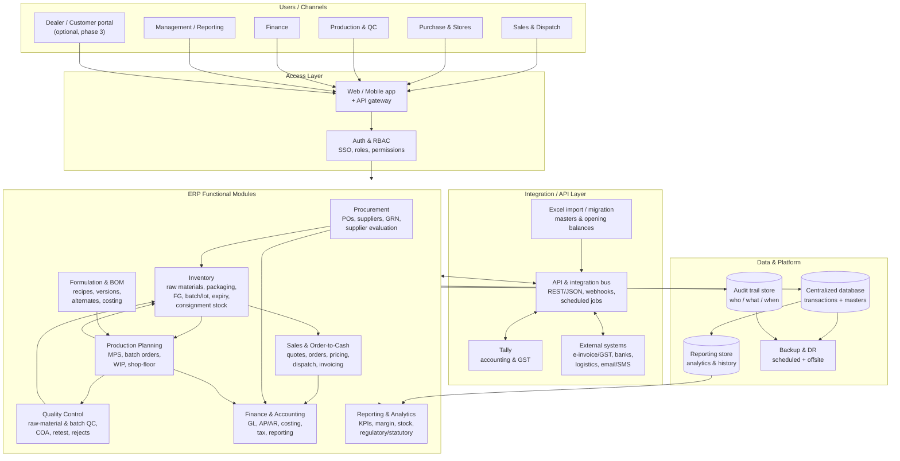

# Task 3 — ERP Architecture: Paint Manufacturer

**Scenario:** a paint/coatings manufacturer needs an ERP covering procurement through
finance, with paint-specific needs: multiple raw materials (resins, solvents, pigments,
additives), **batch/lot tracking with expiry** (shelf life), **consignment stock** at
dealers, and **product formulation/BOM** with version control.

**Status:** high-level architecture proposal. No vendor-specific infrastructure is assumed;
anything that depends on stakeholder input is marked _(assumption)_.

---

## 1. High-level architecture

---

## 2. Module responsibilities and data flow

**Procurement & supplier management (procure-to-pay).** Purchase requisition → purchase
order → goods receipt (GRN) → supplier invoice matching → payment (AP). Maintains the supplier
master, price/terms history and **vendor performance** scoring (on-time delivery, quality /
rejection rate, price variance). On GRN, stock enters Inventory with its batch/lot and expiry,
and the liability flows to Finance (AP).

**Inventory & stores.** Tracks raw materials, packaging, semi-finished and finished goods
across warehouses and **consignment stock** held at dealers (ownership stays with the
manufacturer until consumption/sale). Paint-specific: batch/lot numbers, **expiry/retest
dates** and shelf life drive FIFO/FEFO issue. Inventory is the hub — it is written by
procurement (receipts), production (consumption/output), QC (accept/reject/hold) and sales
(dispatch).

**Formulation / BOM.** A paint product is defined by a **formula/recipe version** listing
ingredients, quantities and tolerances, plus alternates and packaging. Version control matters:
the same SKU may have multiple approved formula versions, and a batch must record which one it
used for traceability and cost. Formulation feeds production and product costing.

**Production planning & WIP.** Converts demand (sales orders + forecast) into a master
production schedule and **batch orders**. Issues raw materials to a batch (FEFO), records
in-process consumption and yields, tracks **WIP**, and confirms finished output back into
inventory. Paint specifics: batch size rounding, yield/volume variance, and multi-stage
mixing where intermediate bulk becomes an input to later batches.

**Quality control.** Inspection at raw-material receipt, in-process and finished-goods stages.
Records results, specification limits, **Certificates of Analysis (COA)**, pass/fail/hold
dispositions, retest dates and rejects. QC disposition gates stock movement, so Inventory only
releases passed material.

**Sales, order processing, dispatch & order-to-cash.** Quote → sales order → availability and
pricing check with **tiered pricing** (by customer/dealer class, volume and product), plus a
credit check → pick/pack (FEFO, from own or consignment stock) → **dispatch** with transport
documents → invoice → receipts → returns/credit notes. Order-to-cash closes when the invoice is
settled in Finance.

**Finance, accounting & reporting.** General ledger, AP/AR, tax, inventory valuation and product
costing (from formulation + production actuals), plus statutory/regulatory reporting. Finance is
fed by procurement (payables), sales (receivables), production (cost) and inventory (valuation).

**Reporting & analytics.** Operational KPIs (stock cover, expiry exposure, batch yield, OTIF,
margin by product/dealer), plus statutory reports. Served from a reporting store so heavy
queries never slow transaction entry.

---

## 3. Integrations

- **Tally** — the accounting/GST system of record for statutory books where the customer
  already uses it. The ERP exchanges vouchers (sales, purchase, journal), masters (ledgers,
  items, parties) and tax details through the **API/integration bus**, using Tally's supported
  import/export interfaces. Direction and ownership of each master must be agreed so the two
  systems do not fight over the same data _(assumption: Tally remains the statutory books and
  the ERP pushes vouchers to it)_.
- **Excel migration/import** — a controlled import path for opening masters (customers,
  suppliers, items, formulas, opening stock/balances) and periodic bulk data, with **validation,
  dry-run, error reporting and idempotency** so a bad file cannot corrupt data.
- **External systems** — e-invoicing/GST portals, banking/payment files, logistics/transport for
  dispatch tracking, and email/SMS for order and dispatch notifications. All through the bus,
  never point-to-point from a module.

**Integration-layer principles:** one **API/integration layer** mediates all external traffic;
contracts are versioned and documented; integrations are asynchronous with retries and a
dead-letter queue where possible; every integration writes to the audit trail.

---

## 4. Platform concerns

- **Centralized database** — one transactional store for masters and transactions, so batch
  traceability and financial postings are consistent. A separate read store serves reporting.
- **Authentication & authorization** — central auth with **RBAC** (roles such as sales,
  stores, production, QC, finance, admin), scoped permissions per module/warehouse/company, and
  SSO against the company directory where available.
- **Audit trails** — append-only records of who did what and when for every critical action
  (stock movements, batch dispositions, price/credit changes, journal postings, master edits),
  for both operations and statutory audit.
- **Backups & DR** — automated scheduled backups with offsite/geo-redundant copies, documented
  restore procedures and periodic restore drills; defined RPO/RTO _(values are assumptions)_.
- **Automation & analytics** — scheduled/event-driven jobs (document numbering, MRP runs,
  auto-replenishment suggestions, reminders/dunning, end-of-day postings) plus analytics over
  the reporting store (margin, stock cover, expiry exposure, vendor performance, OTIF).

---

## 5. Scaling, security and data migration

- **Scaling** — module boundaries allow independent scaling; the transactional database scales
  vertically first and horizontally via read replicas/sharding on tenant or entity boundaries if
  needed; reporting is isolated from transactional load; long-running jobs (MRP, costing,
  migrations) run off the interactive path.
- **Security** — encrypted transport and storage, least-privilege roles, segregation of duties
  (e.g. creator of a PO is not its approver), audit logging, and no direct database access for
  end users. Data is partitioned by company/plant where relevant.
- **Data migration** — phased: extract from the legacy system and Excel → map and cleanse →
  load masters first, then opening balances and open transactions → reconcile totals against the
  legacy source → sign off → cut over. Migrations must be repeatable and reversible, and every
  loaded record is attributed in the audit trail.

---

## 6. Phased rollout

| Phase | Scope | Outcome |
| --- | --- | --- |
| 1 — Foundation | Masters, users/RBAC, inventory, procurement | Trustworthy stock and purchasing |
| 2 — Manufacturing | Formulation/BOM, production planning, WIP, QC | Batch-tracked production with quality gates |
| 3 — Commercial | Sales, dispatch, order-to-cash, invoicing | Order-to-cash closed in the ERP |
| 4 — Finance | GL, costing, AP/AR, Tally integration, statutory reporting | Books and reporting from the ERP |
| 5 — Extended | Dealer/consignment portal, analytics, further integrations | Scale and insight |

Each phase ends with reconciliation against the legacy process before the next begins.

---

## 7. Risks

- **Batch/expiry discipline** — if shop-floor users bypass FEFO/QC holds, traceability fails;
  mitigated by enforcing dispositions in the workflow, not by policy alone.
- **Two books of record** — running Tally and the ERP in parallel without a clear owner per
  master causes drift; mitigated by agreeing master ownership up front.
- **Consignment stock complexity** — ownership/valuation differs from owned stock; requires
  explicit stock-state modelling from day one.
- **Data migration quality** — dirty legacy/Excel data is the most common cause of overruns;
  mitigated by cleanse-and-reconcile before cutover.
- **Change management** — new processes on the shop floor need training and phased adoption;
  mitigated by a pilot line/plant before full rollout.
- **Scope creep** — automotive-style customization can balloon; mitigated by the phase gates
  above.

---

## 8. Open questions _(assumptions to confirm)_

1. Is **Tally** the statutory books of record, or does the ERP own finance and only exchange
   summaries?
2. Are multi-company / multi-plant / multi-GSTIN structures in scope?
3. Which regulatory and statutory reports are mandatory, and in which formats?
4. How is **consignment stock** settled today (consumption-based billing?) and who owns it
   while it sits at a dealer?
5. Is a **dealer/customer self-service portal** required, and in which phase?
6. What is the required **RPO/RTO**, and are on-premises, cloud or hybrid hosting constraints
   in place?
7. Which legacy systems (other than Tally/Excel) must be integrated or retired?
8. What are the target volumes (SKUs, batches/day, dealers, invoices/month) that sizing should
   be based on?
